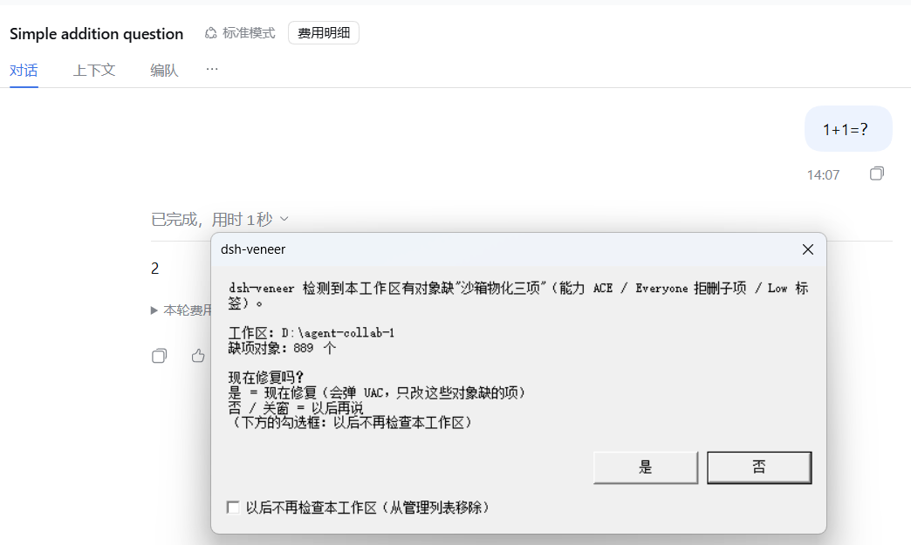
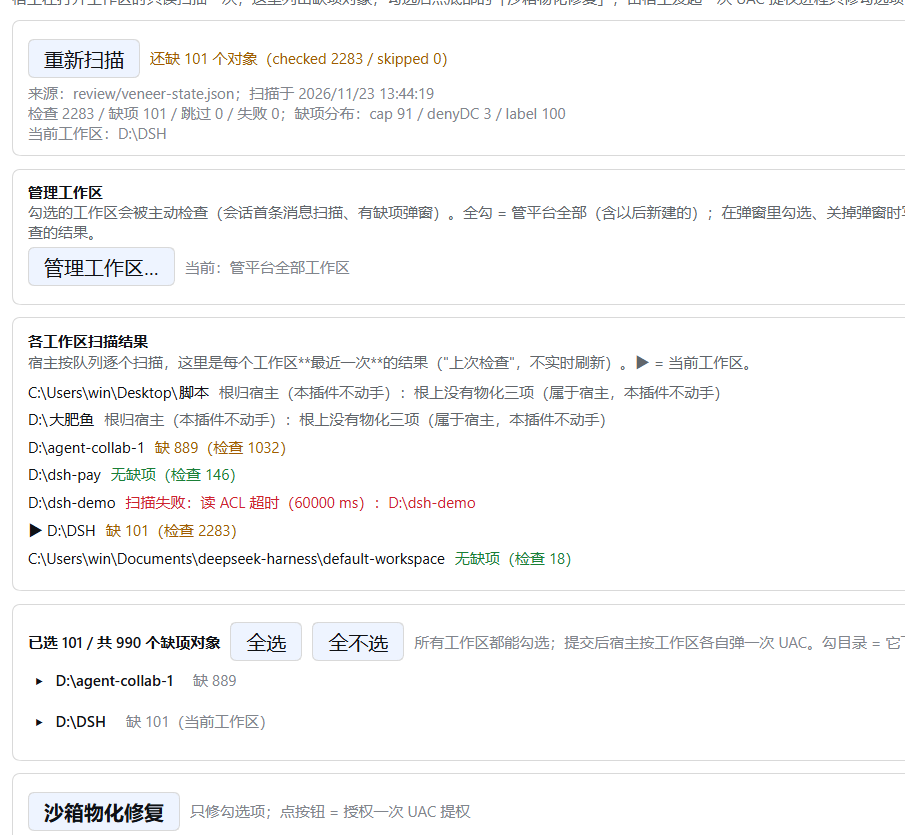
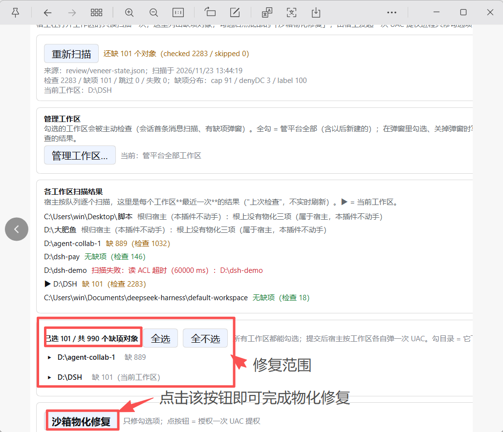
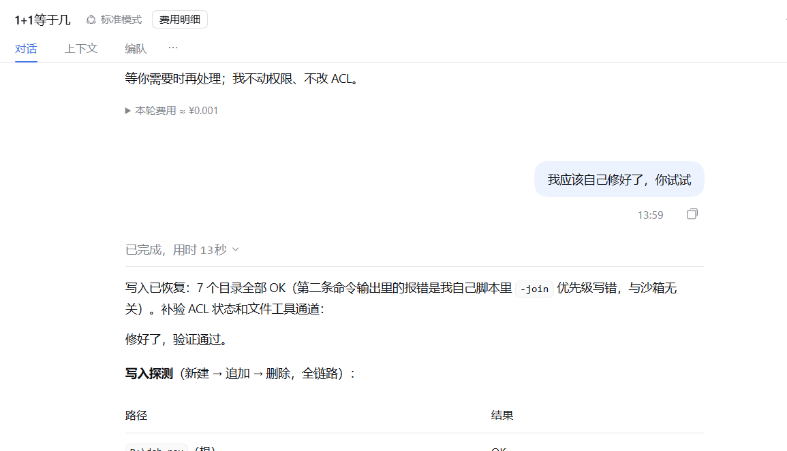
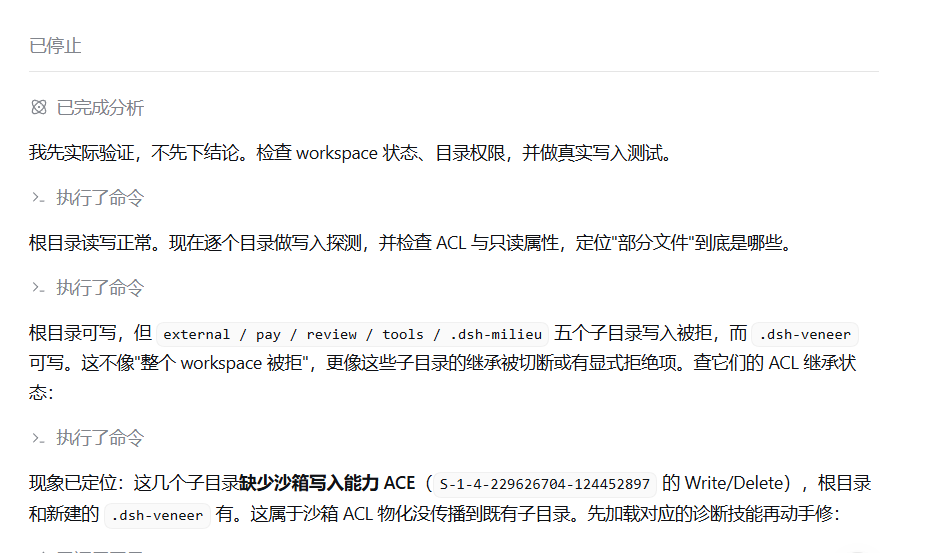

# dsh-veneer

**Windows 上 DSH 工作区"物化体检"。** 检查哪些目录缺了沙箱需要的权限项，用弹窗或面板告诉你；你点确认、过 UAC，它才只修你勾的那些——插件自己从不自动改 ACL。

> Windows-only · 配合 DSH 使用 · MIT

---

## 一分钟看懂

- **问题**：DSH 的 Windows 沙箱靠三项东西工作：一条允许读写的权限规则、一条禁止删除子项的规则、一个"低完整性"标签。这三项只在目录**创建时**自动加上，**不会回头补已经存在的目录**。于是从别处搬来、解压出来、旧仓库拉进来的目录经常"根目录能写、子目录不能写"，报错还只说"拒绝访问"。
- **插件**：扫一遍 → 列出缺项 → 弹窗 / 面板提示 → 你确认后走 UAC 只修勾选项。
- **安全边界**：不自动改、不全盘改、不绕过沙箱；关掉弹窗不会改任何东西。

---

## 快速开始

### 安装

在 DSH 的插件管理里选「从 GitHub 安装」，填：

```
github:sxwpskd/dsh-veneer
```

（要固定版本可以加 `#v0.4.12`。）装完**完全重启 DSH**，宿主模块才会加载。

### 路一：开个新对话，让它问你（最快）

1. 随便开一个**新对话**，发第一句话——哪怕只是"你好"；
2. 插件会扫描这个会话所属的工作区，有缺项就直接弹窗；
3. 点「是」→ 在 UAC 里确认 → 它只修这些对象缺的项 → 自动重扫。



弹窗的选项很简单：

- **是** = 现在修（会弹 UAC）；
- **否 / 关窗** = 以后再说，**不改任何权限**；
- 下方勾选「以后不再检查本工作区」= 把它从管理列表里移除。

同一段对话只检查一次。就算关了弹窗，扫描结果也会同步到配置页，随时可以再处理。

### 路二：去配置页，自己挑着修（更可控）

1. 打开插件配置页，看「各工作区扫描结果」：
   
2. 在下方清单勾选要修的对象——**勾一个目录会自动带上它下面的缺项**；
3. 点「沙箱物化修复」→ UAC 确认 → 等它跑完刷新。



两条路用的是同一套检查结果：路一是"发现就问我"，路二是"我自己挑着修"。

### 修好之后

写入恢复，新建 → 追加 → 删除整条链路通过：



---

## 为什么会出现"明明有权限却写不进去"

典型案例：根目录正常，`external`、`review`、`tools` 这些子目录写入全被拒。



查下去会发现，子目录少了沙箱需要的权限项；新建目录（比如插件自己的 `.dsh-veneer`）反而是齐的。**这不是"没给权限"，是物化没传播到既有目录。**

想手工修也能修，但要逐目录补 ACL、设置低完整性标签、补禁止删除子项的规则，每条命令都长、易错，而且改权限必须提权。更耗时间的是排查——系统只报"拒绝访问"，很容易先怀疑沙箱没开、路径写错、AI 指令有问题。

所以有了这个插件：**把"哪缺、缺什么"说清楚，把"修"变成你点一下确认。**

---

## 它刻意不做什么

- **不自动改 ACL**：所有权限修改都必须你点按钮、并亲自在 UAC 里确认；
- **只修你勾的对象**：不做"全盘一把梭"；
- **不绕过沙箱**：只把沙箱本来就该有的项补回去，不扩大 AI 的权限；
- **不碰工作区根**：根目录由 DSH 宿主自己管理，不属于本插件的覆盖范围；
- **不监控每轮对话**：一次扫描只保证当时那棵树；之后搬进来的内容，下次扫描才看得见。

---

## 高级：命令行修复与回滚

面板和弹窗背后用的是同一套脚本。也可以在提权 PowerShell 里手动跑：

```powershell
# 干跑：只读，打印"会补哪些、怎么补"
powershell -NoProfile -ExecutionPolicy Bypass -File "<包目录>\scripts\dsh-veneer-apply.ps1" -Root "<工作区>" -Cap -DenyDC -Label

# 真修：先备份到 <工作区>\.dsh-veneer-backup\<时间>\，再逐对象补，最后自检
powershell -NoProfile -ExecutionPolicy Bypass -File "<包目录>\scripts\dsh-veneer-apply.ps1" -Root "<工作区>" -Cap -DenyDC -Label -Apply

# 回滚
powershell -NoProfile -ExecutionPolicy Bypass -File "<包目录>\scripts\dsh-veneer-apply.ps1" -Root "<工作区>" -Restore -RestoreDir "<备份目录>"
```

退出码：`0` 正常 / `2` 参数错 / `3` 根或备份不存在 / `6` 拒绝（根没物化或是 reparse point）/ `7` 备份失败（什么都没改）/ `8` 有对象改失败 / `9` 自检仍有缺项。

---

## 配置（`cordis.patch.yml` 补丁层）

| 键 | 默认 | 说明 |
| --- | --- | --- |
| `workspaces` | `[]` | **空 = 管平台全部工作区**；非空 = 只管列出的这些。面板「管理工作区」写它 |
| `workspaceRoot` | `''` | 内部兜底：平台工作区表读不到时用它 |
| `reportPath` | `review/veneer-state.json` | 报告写在工作区里的相对路径 |
| `listLimit` | `50000` | 一次最多列多少对象（超了报告 `partial`） |
| `scanTimeoutMs` | `60000` | 单次读 ACL 的超时 |
| `readyWaitMs` | `10000` | 等工作区服务就绪的时长 |
| `scanOnMount` | `true` | 工作区打开后自动扫一次 |

报告形状与边界说明见下方"结构"里的 `core/`、`model/`。

---

## 结构

```
plugin/dsh-veneer/plugin/        ← 本仓库的根
├── index.js                     # 入口：按 workspaces 挂 child fiber（一个工作区一个实例）
├── core/                        # 纯逻辑：判缺 / 报告 / 命令 / 采集 / 落盘 / 扫描编排 / 多工作区汇总
├── adapter/                     # 宿主与服务的外部边界（唯一出现宿主服务名；唯一起子进程的地方）
├── model/                       # 数据形状（签名 / 报告版本 / 状态词）
├── config/                      # 默认值 + 深合并（0 / '' / false 是合法值）
├── exception/                   # 稳定错误码 / 统一结果 / 异常边界
├── log/                         # 日志层（JSONL 文件 sink + 内存环）
├── scripts/                     # 提权执行侧（只读探针 + apply/restore）
├── ui/                          # 客户端面板源码；lib/client.js 是构建产物
├── docs/images/                 # README 用图
└── tools/                       # 开发脚本（边界检查 / 干跑），不进发布
```

## 开发

- 测试不在包里：工作区的 `tools/veneer-test.mjs`、`tools/veneer-v2-test.mjs`、`tools/veneer-log-test.mjs`，统一入口 `node tools/run-tests.mjs`；
- 边界检查：`node plugin/dsh-veneer/plugin/tools/check.mjs`；
- 想先看结论不跑插件：`node plugin/dsh-veneer/plugin/tools/dryrun.mjs --root <工作区>`（只读，不写盘）；
- 行尾：源码 LF；`.ps1` 保持 CRLF（`.gitattributes` 钉住）。

## 边界

- **Windows-only**：物化三项是 NTFS 语义；其它平台挂载即报告 `unsupported`，什么都不做；
- **不碰根**、不碰 reparse point、不碰读不到安全描述符的对象；
- **不改宿主**、不注册任何全局处理器；
- **可移除**：卸载只停扫描；报告文件留着（那是工作区里的材料）；已补的 ACL 不会自动回滚，要用上面的 `-Restore` 手动回滚；
- 许可证：MIT。
